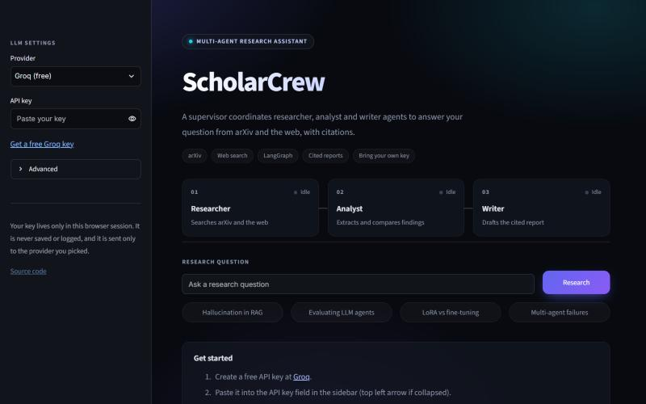
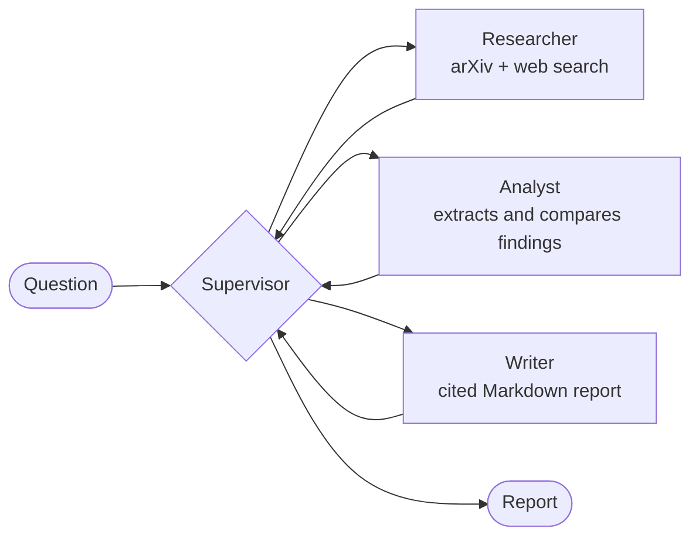

# ScholarCrew

A multi-agent research assistant. Ask a question and a team of AI agents researches it on arXiv
and the web, then writes a report with citations.

[](https://github.com/omsawant-ds/scholarcrew/actions/workflows/ci.yml)
[](LICENSE)

**[Live demo](https://scholarcrew.streamlit.app)** &middot; **[Sample report](docs/sample-report.md)**



The demo uses a bring-your-own-key model: paste a free Groq or Gemini API key into the sidebar.
The key stays in your browser session and is never stored or logged.

## How it works



A [LangGraph](https://github.com/langchain-ai/langgraph) supervisor routes work between three
agents:

- **Researcher** plans search queries, then gathers papers from arXiv and pages from the web.
- **Analyst** extracts the key findings, compares sources, and flags weak evidence.
- **Writer** drafts the final report from the analyst's notes.

### Design decisions

- **Routing is validated, not trusted.** Free and small models often return malformed JSON. The
  supervisor checks every routing decision, ignores ones that repeat finished work, and falls back
  to a fixed researcher, analyst, writer order. A step cap guarantees the run always ends.
- **Citations cannot be invented.** The reference list is built from the sources that were actually
  retrieved, not written by the model.
- **Failures are visible.** If the model or provider errors, the agents degrade gracefully and log
  a warning instead of failing silently. The web app runs a one-call preflight so a bad key or
  model name gives a clear message before any work starts.
- **Provider-agnostic.** Any OpenAI-compatible endpoint works: Groq, Gemini, Ollama, vLLM.
- **Tested offline.** The test suite uses a scripted fake model and fake search tools, so it needs
  no network and no API key.

## Sample output

[`docs/sample-report.md`](docs/sample-report.md) is a real, unedited report for the question
*"What are the main techniques for evaluating LLM agents?"* It cites 16 sources.

## Evaluation

An automated pipeline scores every report on faithfulness, numeric grounding, citation validity
and coverage, relevance and structure, using a separate judge model.

```bash
python -m scholarcrew.evaluation --quick
```

It was used to find and fix a real problem. The first runs showed the agents inventing
statistics that appeared in none of the retrieved sources. After giving the analyst the full
abstracts and adding explicit rules about figures, on the same 5 questions with a different
model judging:

| Metric | Before | After |
|---|---|---|
| Faithfulness (cited claims the sources support) | 22% | **56%** |
| Numeric grounding (statistics found in the cited source) | 0% (n=1) | **56%** (n=3) |
| Citation coverage | 21% | **32%** |

This is a small sample and about 44% of statistics are still unsupported, so it is a measured
improvement and not a solved problem. Method, per-question results and limitations are in
[`docs/evaluation.md`](docs/evaluation.md).

## Run it locally

```bash
python -m venv .venv
.venv/Scripts/activate          # Windows; use `source .venv/bin/activate` on macOS/Linux
pip install -e ".[app]"
cp .env.example .env            # add a free Groq or Gemini key, or point at Ollama
```

Command line:

```bash
scholarcrew "How do researchers reduce hallucination in RAG systems?"
```

Web app:

```bash
streamlit run streamlit_app.py
```

### Configuration

Set `LLM_BASE_URL`, `LLM_API_KEY` and `LLM_MODEL` in `.env`. The file has ready-made presets for
Groq, Gemini and Ollama. The web app ignores `.env` and asks each visitor for their own key.

## Deploy your own copy (free)

1. Fork this repo and sign in at [share.streamlit.io](https://share.streamlit.io) with GitHub.
2. Click **Create app**, pick your fork, branch `main`, main file `streamlit_app.py`.
3. Under **Advanced settings**, choose Python 3.12. No secrets are needed.
4. Deploy. Dependencies come from `requirements.txt`.

Free apps sleep after a period without traffic and wake when someone visits.

## Project layout

```
src/scholarcrew/
  agents/        supervisor, researcher, analyst, writer
  tools/         arXiv search, web search, report saving
  evaluation/    scoring pipeline: metrics, judge, runner, question set
  graph.py       LangGraph wiring
  providers.py   provider presets and key check
  config.py      settings from environment
  cli.py         command-line entry point
streamlit_app.py web app
tests/           offline tests (fake model, fake search)
docs/            screenshot, sample report, evaluation method and results
```

## Development

```bash
pip install -e ".[dev]"
pytest
ruff check src tests streamlit_app.py
```

## Roadmap

- [x] Multi-agent research system with a web app
- [x] Automated evaluation pipeline: scored test questions for faithfulness, citation accuracy and relevance
- [ ] Stop unsupported figures and uncited reports: about 1 report in 5 still comes back with no citations
- [ ] LoRA fine-tuned writer model, compared against the base model with the evaluation pipeline

## License

MIT
