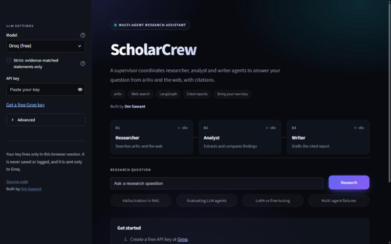
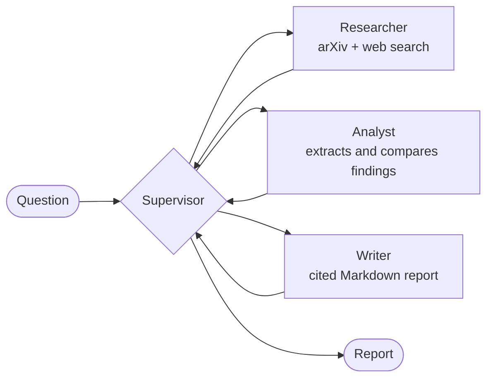

# ScholarCrew

A multi-agent research assistant. A supervisor coordinates researcher, analyst and writer agents
to answer a question from arXiv and the web with a cited report.

[](https://github.com/omsawant-ds/scholarcrew/actions/workflows/ci.yml)
[](LICENSE)

**[Live demo](https://scholarcrew.streamlit.app)** &middot; **[Sample report](docs/sample-report.md)** &middot; **[Evaluation](docs/evaluation.md)**



The demo is bring-your-own-key: paste a free [Groq](https://console.groq.com/keys) key. It is kept
in the browser session and never stored or logged.

## Architecture



Built on [LangGraph](https://github.com/langchain-ai/langgraph).

- **Validated routing.** The supervisor checks every routing decision and falls back to a fixed
  order on malformed output. A step cap guarantees termination.
- **Citations from retrieved sources only.** The reference list is built from the retrieved
  sources, not written by the model. Each statement carries its own citations, re-pointed to the
  source that best matches it.
- **Visible failures.** Model errors are logged, and the app checks the key and model before
  starting.
- **Offline tests.** A scripted fake model and fake search tools; no network or key needed.

## Evaluation

An automated pipeline scores reports on faithfulness, numeric grounding, citation validity and
coverage, relevance and structure, with a separate judge model. It was used to compare writers
on 30 held-out questions (2 samples each, judge `qwen3.8-27b`):

| Writer | Faithfulness | Faithfulness, citations repaired | Citation coverage |
|---|---|---|---|
| Copy the notes (no model) | 84% | 81% | 49% |
| Qwen3-4B | 55% | 61% | 47% |
| Qwen3-4B + LoRA | 48% | 61% | 88% |

Fine-tuning improved citation coverage, not faithfulness. The citation repair applied in the
app raised both writers to 61%. Limitations (small sample, one judge, repair tuned on the same
questions) are in [docs/evaluation.md](docs/evaluation.md).

## Run locally

```bash
pip install -e ".[app]"
cp .env.example .env          # set LLM_API_KEY to your Groq key
scholarcrew "How do researchers reduce hallucination in RAG systems?"
streamlit run streamlit_app.py
```

## Deploy

On [share.streamlit.io](https://share.streamlit.io): create an app from your fork, branch `main`,
file `streamlit_app.py`, Python 3.12. No secrets are needed.

## Development

```bash
pip install -e ".[dev]"
pytest
ruff check .
```

## License

MIT
